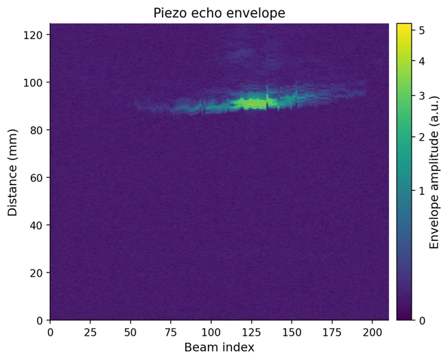

# Probe Localisation

*Work in progress. Further details will be shared after publication.*

### Overview
This project explores localizing a small piezoelectric receiver relative to a clinical ultrasound probe using the probe's own imaging pulses, with no change to the probe or its imaging sequence. The motivating application is needle-tip tracking during ultrasound-guided procedures, where the tip can be hard to follow and existing tracking solutions add hardware, cost, and workflow steps. The longer-term goal is to work without an external tracker.

---

### Idea
As the probe fires across its 210-element aperture, each pulse reaches the receiver at a different time. Across a full frame, these arrival times form a pattern that depends on where the receiver sits relative to the probe.

*Envelope of the received signal across all 210 beams.*

---

### Setup
A custom oscilloscope-based capture system records the probe drive signal and the receiver output together. Electromagnetic tracking provides ground truth in the lab, and an IMU provides probe orientation.

### My role
Designed and built the acquisition system and the signal-processing pipeline, and ran the experiments and analysis.

### Methods
Acoustic time-of-flight sensing, ultrasound instrumentation, signal processing, electromagnetic tracking, IMU integration, experimental design.

### Status
Ongoing (2025 to present). Results will be added after publication.

---

[← Back to Projects](/projects)
